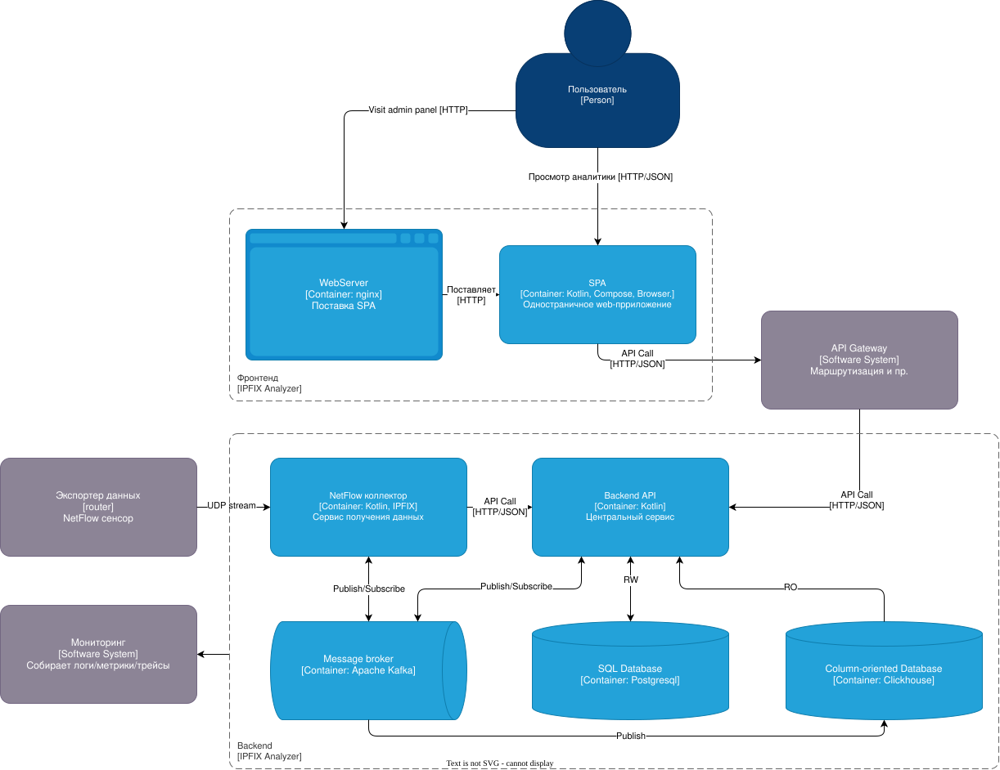

# Анализатор сетевого трафика

Проект представляет собой ПО для сбора данных о трафике сетевого оборудования, хранения и дальнейшего анализа. Импорт данных осуществляется по протоколу [NetFlow v10](https://datatracker.ietf.org/doc/html/rfc7011) (он же IPFIX).

### Основные функции системы
- получение метаданных о сетевом трафике от NetFlow-сенсора
- обогащение метаданных из внешних источников
- построение динамических отчетов и дашбордов
- поиск аномалий
- алерты

### Целевая аудитория и портреты клиентов

Проект учебный, поэтому целевой адуитории нет, так же как и портретов клиентов, тем не менее подобные системы были бы интересны сетевым админстраторам компаний, или интернет-провайдерам

### Описание MVP
- получение данных от сенсора
- просмотр активных сенсоров
- CRUD информационных элементов
- сохранение получаемых данных в хранилище для дальнейшей аналитики
- конструктор отчетов

### Эскизы фронтенд-представления

* Главный экран
```
┌─────────────────────┬─────────────────────────────────────────────────────────┐
│  NetFlow Analytics  │  [ Заголовок раздела ]                                  │
├─────────────────────┼─────────────────────────────────────────────────────────┤
│  Сенсоры            │                                                         │
│  Отчеты             │                                                         │
│  Справочники        │                  Рабочая область экрана                 │
│                     │                                                         │
│                     │                                                         │
└─────────────────────┴─────────────────────────────────────────────────────────┘
```
* Сенсоры
```
┌────────────────────────────────────────────────────────────────────────────────┐
│ АКТИВНЫЕ СЕНСОРЫ (Всего: 3 | Online: 2 | Offline: 1)            [ ↻ Обновить ] │
├────────────────────────────────────────────────────────────────────────────────┤
│ Статус    │ Название / IP          │ Domain ID │ Пакетов       │ Действия      │
│ ──────────┼────────────────────────┼───────────┼───────────────┼────────────── │
│ ● ONLINE  │ Core-Router-MSK        │ 1001      │ 1,450,230     │ [Шаблоны]     │
│           │ 10.255.255.1           │           │ (2 сек назад) │ [ ✎ ] [ 🗑 ]  │
│ ──────────┼────────────────────────┼───────────┼───────────────┼────────────── │
│ ● ONLINE  │ Linux-Test-Agent       │ 0         │ 14,820        │ [Шаблоны]     │
│           │ 192.168.1.100          │           │ (5 сек назад) │ [ ✎ ] [ 🗑 ]  │
│ ──────────┼────────────────────────┼───────────┼───────────────┼────────────── │
│ ○ OFFLINE │ Old-Router-DHCP        │ 0         │ 5,100         │ [Шаблоны]     │
│           │ 192.168.1.55           │           │ (3 дня назад) │ [ ✎ ] [ 🗑 ]  │
└────────────────────────────────────────────────────────────────────────────────┘

  ▼ Модальное окно / выдвижная панель при нажатии на [Шаблоны] у Core-Router-MSK:
  ┌─────────────────────────────────────────────────────────────────────────┐
  │ Шаблон ID: 256 (Обновлен: 12:05:10)                                     │
  │ Поля в пакете:                                                          │
  │  1. [ID: 8]   src_ip (IP отправителя) — 4 байта                         │
  │  2. [ID: 12]  dst_ip (IP получателя) — 4 байта                          │
  │  3. [ID: 7]   src_port (Порт отправителя) — 2 байта                     │
  │  4. [ID: 11]  dst_port (Порт получателя) — 2 байта                      │
  │  5. [ID: 1]   bytes (Трафик) — 8 байт                                   │
  │  6. [Ent: 9, ID: 12234] cisco_app_name (Неизвестно — добавить?) [ + ]   │
  └─────────────────────────────────────────────────────────────────────────┘
  
  ┌─────────────────────────────────────────────────────────┐
  │ Удалить сенсор «Old-Router-DHCP» (192.168.1.55)?        │
  │                                                         │
  │ Будут удалены карточка сенсора и его сохраненные        │
  │ шаблоны. Исторические данные трафика останутся доступны │
  │ в отчетах.                                              │
  │                                                         │
  │                                                         │
  │                                 [ Отмена ]  [ Удалить ] │
  └─────────────────────────────────────────────────────────┘
  
  ┌─────────────────────────────────────────────────────────┐
  │ Редактирование сенсора                                  │
  ├─────────────────────────────────────────────────────────┤
  │                                                         │
  │ Внутренний ID:  550e8400-e29b-41d4-a716-446655440000    │
  │ Domain ID:      0                                       │
  │                                                         │
  │ Название сенсора:                                       │
  │ [ Core-Router-MSK                                     ] │
  │                                                         │
  │ Текущий IP-адрес (если устройство сменило IP):          │
  │ [ 10.255.255.1                                        ] │
  │                                                         │
  │ Статус:  (•) Активен    ( ) В архиве (скрыт из списка)  │
  │                                                         │
  ├─────────────────────────────────────────────────────────┤
  │                               [ Отмена ]  [ Сохранить ] │
  └─────────────────────────────────────────────────────────┘
```
* Справочники
```
┌────────────────────────────────────────────────────────────────────────────────┐
│ ИНФОРМАЦИОННЫЕ ЭЛЕМЕНТЫ (СХЕМА ДАННЫХ)                 [ + Добавить элемент ]  │
│                                                                                │
│ Поиск: [ По имени или ID...     ]   Фильтр по роли: [ Все ▾ ] [ KEY ] [ METRIC ]
├────────────────────────────────────────────────────────────────────────────────┤
│ Enterprise │ Element ID │ Системное имя │ Название в UI   │ Тип    │ Роль      │
│ ───────────┼────────────┼───────────────┼─────────────────┼────────┼───────────│
│ 0 (IANA)   │ 8          │ src_ip        │ IP отправителя  │ IPV4   │ KEY       │
│ 0 (IANA)   │ 12         │ dst_ip        │ IP получателя   │ IPV4   │ KEY       │
│ 0 (IANA)   │ 1          │ bytes         │ Трафик (байты)  │ UINT   │ METRIC    │
│ 9 (Cisco)  │ 12234      │ cisco_app     │ Приложение      │ STRING │ KEY ✎ 🗑  │
└────────────────────────────────────────────────────────────────────────────────┘
  ▼ Модальное окно при нажатии [ + Добавить элемент ]:
  ┌─────────────────────────────────────────────────────────┐
  │ Новый информационный элемент                            │
  │                                                         │
  │ Enterprise ID:  [ 9               ] (0 для стандарта)   │
  │ Element ID:     [ 12234           ]                     │
  │ Системное имя:  [ cisco_app       ] (только латиница)   │
  │ Название в UI:  [ Приложение      ]                     │
  │ Тип данных:     [ STRING        ▾ ]                     │
  │ Роль поля:      (•) Ключ (KEY)   ( ) Метрика (METRIC)   │
  │                                                         │
  │                               [ Отмена ]  [ Сохранить ] │
  └─────────────────────────────────────────────────────────┘
```
* Отчеты
```
┌──────────────────────────────────────────────────────────────────────────────┐
│ ПАРАМЕТРЫ ЗАПРОСА                                                            │
│                                                                              │
│ Сенсор: [ Все сенсоры ▾ ]      Период: [ Последний 1 час ▾ ]   Шаг: [ 1m ▾ ] │
│                                                                              │
│ Группировка (Keys):    [ src_ip × ] [ dst_port × ] [ + Добавить поле ▾ ]     │
│ Метрики (Metrics):     [ SUM(bytes) × ] [ SUM(packets) × ] [ + Метрика ▾ ]   │
│                                                                              │
│ Фильтры (WHERE):       [ protocol ▾ ] [ = ▾ ] [ 6      ] [ 🗑 ]              │
│                        [ + Добавить условие ]                                │
│                                                                              │
│                                               [ Сбросить ]  [ ▶ Выполнить ]  │
├──────────────────────────────────────────────────────────────────────────────┤
│ ВИЗУАЛИЗАЦИЯ (Тип: [ Линейный график ▾ ] / [ Столбцы ] / [ Только таблица ]) │
│                                                                              │
│  500 MB ┤        ╭──╮                                                        │
│  250 MB ┤   ╭────╯  ╰───╮      ╭───╮                                         │
│    0 MB ┼───┴───────────┴──────┴───┴──────────────────────────────────────   │
│         11:00         11:15        11:30        11:45        12:00           │
├──────────────────────────────────────────────────────────────────────────────┤
│ РЕЗУЛЬТАТЫ (Найдено строк: 100 | Время выполнения: 42 мс)                    │
│                                                                              │
│  IP отправителя (src_ip)  │ Порт (dst_port) │ Трафик (bytes) │ Пакеты        │
│ ──────────────────────────┼─────────────────┼────────────────┼────────────── │
│  192.168.1.45             │ 443             │ 1.42 GB        │ 1,045,200     │
│  10.0.0.12                │ 22              │ 340.5 MB       │ 412,110       │
│  192.168.1.88             │ 53              │ 12.1 MB        │ 98,400        │
└──────────────────────────────────────────────────────────────────────────────┘
```

### Описание сущностей приложения
1. **InformationElement** (Информационный элемент) - правило интерпретации одного конкретного поля протокола IPFIX в едином справочнике системы. 
    * **id** (Уникальный идентификатор) — системный ключ записи.
    * **enterpriseId** (Целое число) — код производителя по реестру IANA (0 для стандартных полей).
    * **elementId** (Целое число) — числовой код поля внутри стандарта или вендора.
    * **fieldName** (Строка) — уникальное машинное имя поля (например, src_ip, bytes).
    * **displayName** (Строка) — человекочитаемое название для UI (например, «IP отправителя»).
    * **dataType** (Перечисление) — физический тип данных (IPV4, IPV6, UNSIGNED_INT, SIGNED_INT, FLOAT, STRING, MAC_ADDRESS, BOOLEAN, TIMESTAMP_MS, TIMESTAMP_SEC).
    * **role** (Перечисление) — аналитическая роль поля: KEY (измерение для фильтрации и группировки) или METRIC (количественный показатель для агрегаций).
    * **isSystem** (Логический флаг) — признак базового элемента, защищенного от удаления.

2. **Sensor** (Сенсор / Экспортер) - сетевое устройство или агент, отправляющий IPFIX-пакеты в систему.
    * **id** (UUID) — постоянный неизменяемый идентификатор сенсора.
    * **name** (Строка) — пользовательское название сенсора.
    * **currentIp** (IP-адрес) — актуальный сетевой адрес, с которого приходят пакеты.
    * **observationDomainId** (Целое число) — логический идентификатор домена наблюдения из заголовка пакета.
    * **firstSeenAt** (Дата и время) — момент первой регистрации сенсора.
    * **lastSeenAt** (Дата и время) — момент получения последнего пакета (для вычисления статуса ONLINE / OFFLINE).
    * **packetsReceived** (Целое число) — накопительный счетчик принятых пакетов.
    * **isArchived** (Логический флаг) — признак мягкого удаления (архивации).

3. **IpfixTemplate** (Шаблон данных сенсора) - заголовок и метаданные конкретной структуры пакетов данных, анонсированной сенсором.
    * **id** (Уникальный идентификатор) — внутренний ключ шаблона в системе.
    * **sensorId** (UUID) — идентификатор сенсора-владельца.
    * **observationDomainId** (Целое число) — домен наблюдения, в рамках которого действует шаблон.
    * **templateId** (Целое число) — номер шаблона, назначенный сенсором (≥ 256).
    * **updatedAt** (Дата и время) — момент последнего получения или обновления описания этого шаблона.

4. **TemplateField** (Поле шаблона данных) - Отдельная сущность, описывающая конкретную позицию (слот) внутри шаблона и его размер в байтах.
    * id (Уникальный идентификатор) — системный ключ записи.
    * templateId (Уникальный идентификатор) — ссылка на родительский шаблон (IpfixTemplate.id).
    * position (Целое число) — порядковый номер поля внутри шаблона (0, 1, 2...), определяющий строгое смещение при чтении байтов.
    * enterpriseId (Целое число) — код производителя, присланный в пакете шаблона.
    * elementId (Целое число) — код информационного элемента, присланный в пакете шаблона.
    * length (Целое число) — размер значения этого поля в байтах внутри пакета данных.

5. **FlowRecord** (Запись сетевого потока) - нормализованное событие одного сетевого соединения, извлеченное из пакета данных.
    * **timestamp** (Дата и время) — единая опорная временная метка события.
    * **sensorId** (UUID) — постоянный идентификатор сенсора, зафиксировавшего поток.
    * **exporterIp** (IP-адрес) — фактический IP-адрес сенсора в момент отправки пакета.
    * **flowData** (Словарь «Ключ — Значение») — динамический набор распарсенных атрибутов и метрик потока, где ключом выступает InformationElement.fieldName, а значением — декодированные данные.

### Описание API

* Система и справочники UI

    * GET /api/v1/dictionaries — получение списков из Enum для выпадающих меню UI (dataTypes, roles, aggregations, filterOperators).

* Справочник элементов (InformationElement)

    * GET /api/v1/elements — получить весь список элементов (для UI и синхронизации коллектора).
    * POST /api/v1/elements — создать кастомный элемент.
    * PUT /api/v1/elements/{id} — отредактировать элемент.
    * DELETE /api/v1/elements/{id} — удалить кастомный элемент (системные элементы IANA защищены).

* Сенсоры и шаблоны (Sensor & IpfixTemplate)

    * GET /api/v1/sensors — список сенсоров с вычисляемым статусом (ONLINE / OFFLINE), текущим IP и статистикой.
    * PATCH /api/v1/sensors/{id} — переименовать сенсор.
    * DELETE /api/v1/sensors/{id} — удалить неактивный сенсор и его шаблоны.
    * GET /api/v1/sensors/{sensorId}/templates — получить активные шаблоны сенсора с расшифровкой полей для UI.
    * GET /api/v1/templates — выгрузка всех шаблонов при старте коллектора для прогрева кэша.
    * POST /api/v1/sensors/heartbeat — прием пакетной статистики от коллектора (и фиксация активности самого коллектора).

* Аналитика (FlowRecord)

    * POST /api/v1/reports/query — выполнение динамического отчета (валидация полей из groupBy, metrics и filters по справочнику, генерация SQL в ClickHouse и возврат готовых данных для графиков и таблиц).

## Диаграмма контейнеров C4


